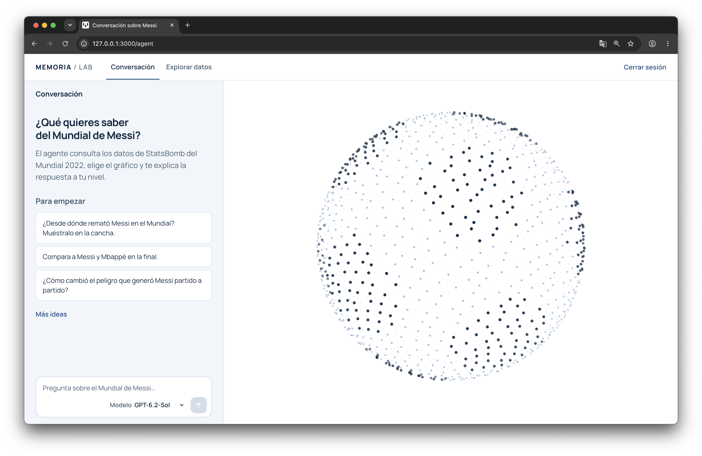
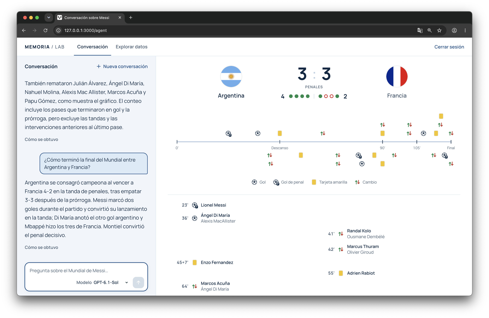
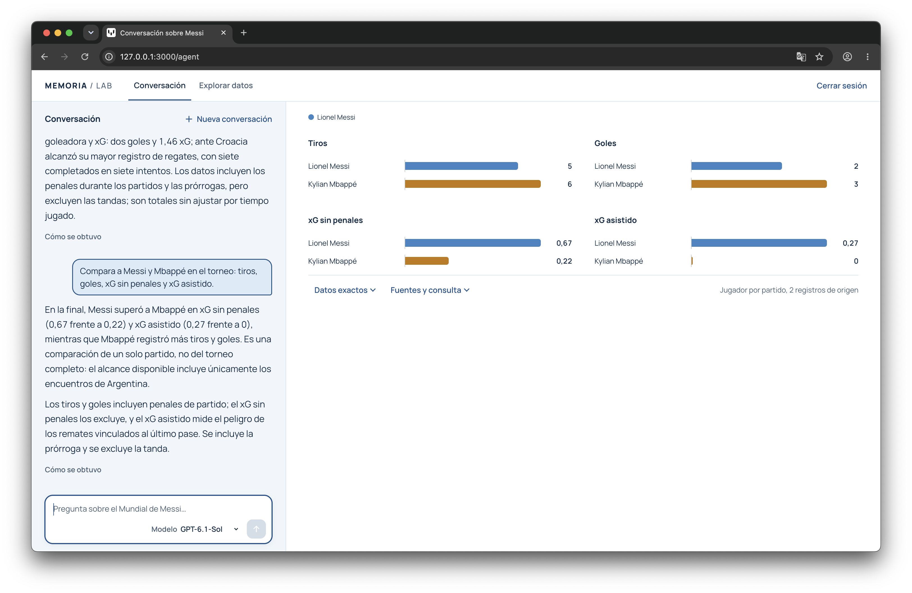

# Messi · Football Data Agent

Explora el Mundial 2022 de Lionel Messi con un agente conversacional respaldado por datos de StatsBomb. La experiencia combina una galería narrativa y visualizaciones interactivas de partidos, alineaciones, tiros y conexiones entre jugadores.

> **Estado:** aplicación local en desarrollo · Interfaz diseñada para escritorio y laptop.

## El prototipo

La propuesta recorre la historia mundialista de Messi y conecta esa narrativa con consultas de datos. Estas pantallas muestran la dirección visual y algunos de los tipos de análisis disponibles.

<p align="center">
  
  
</p>
<p align="center">
  
  
</p>

La [galería completa del prototipo](prototype/README.md) incluye las 16 pantallas narrativas y analíticas.

## Qué puedes explorar

- Datos de los siete partidos de Argentina en el Mundial 2022.
- Consultas en lenguaje natural sobre Messi, sus compañeros, rivales y partidos.
- Mapas de acciones, zonas de actividad, redes de pases, alineaciones y tendencias.
- Resultados y cronologías de partido, cambios de formación y jugadas de tiros creados.
- Catálogo Gold con definiciones, procedencia y límites de cada conjunto de datos.

El agente limita las consultas a los partidos de Argentina en el torneo. No estima datos de seguimiento continuo ni carga física.

## Requisitos

- Python 3.11 o posterior
- Node.js 20.9 o posterior
- Artefactos Gold locales de StatsBomb World Cup 2022
- Cuenta de ChatGPT elegible para autorización OAuth; no se requiere API key

## Preparar el entorno

Desde la raíz del repositorio:

```sh
uv venv .venv
uv pip install --python .venv/bin/python -e 'apps/api[test]'
npm --prefix apps/web ci
.venv/bin/python scripts/discover_gold.py
.venv/bin/python scripts/generate_demo.py
```

## Iniciar la aplicación

En una terminal, inicia la API:

```sh
.venv/bin/python -m uvicorn app.main:app --host 127.0.0.1 --port 8000 --no-access-log
```

En otra terminal, inicia la interfaz:

```sh
npm --prefix apps/web run dev -- --hostname 127.0.0.1 --port 3000
```

Abre [http://127.0.0.1:3000/agent](http://127.0.0.1:3000/agent) y selecciona **Continue with ChatGPT** para autorizar la cuenta. El agente descubre los modelos disponibles para esa cuenta. Sin autorización, puedes explorar los datos y las visualizaciones en modo determinista.

La API guarda el estado local de OAuth en `AGENT_AUTH_STATE_B64` dentro del `.env` de la raíz, con permisos de archivo `0600`. No copies ese valor a `.env.example` ni lo subas al repositorio. El historial autenticado también se almacena localmente.

Si los puertos 8000 y 3000 están ocupados, inicia los servicios con puertos alternativos:

```sh
AGENT_CALLBACK=http://127.0.0.1:8001/auth/callback AGENT_WEB_ORIGIN=http://127.0.0.1:3001 .venv/bin/python -m uvicorn app.main:app --host 127.0.0.1 --port 8001 --no-access-log
API_URL=http://127.0.0.1:8001 NEXT_DIST_DIR=.next-agent npm --prefix apps/web run dev -- --hostname 127.0.0.1 --port 3001
```

En ese caso, abre [http://127.0.0.1:3001/agent](http://127.0.0.1:3001/agent). Usa `127.0.0.1` para que coincida con el callback OAuth.

## Documentación

- [Galería completa del prototipo](prototype/README.md)
- [Guía de demo](docs/DEMO_CHEAT_SHEET.md)
- [Catálogo semántico Gold](docs/GOLD_CATALOG.md) · [esquemas completos](docs/GOLD_CATALOG.json)
- [Entidades: jugadores, selecciones y partidos](docs/GOLD_ENTITIES.json)
- [Arquitectura, seguridad y límites](docs/ARCHITECTURE.md)
- [Estado de verificación](docs/VERIFICATION.md)

## Datos y atribución

Los datos de fútbol provienen de [StatsBomb Open Data](https://github.com/statsbomb/open-data). Las visualizaciones reflejan los eventos disponibles y sus limitaciones; no representan seguimiento continuo de los jugadores.
