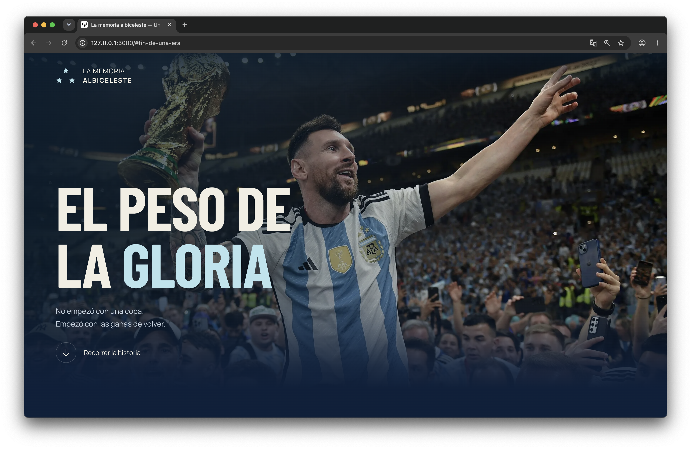
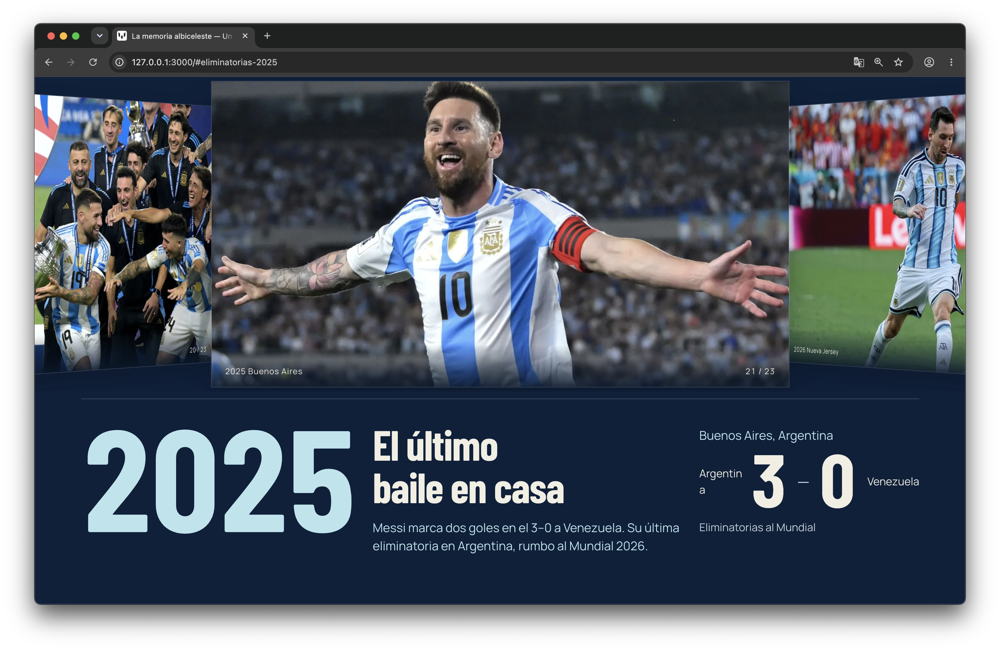
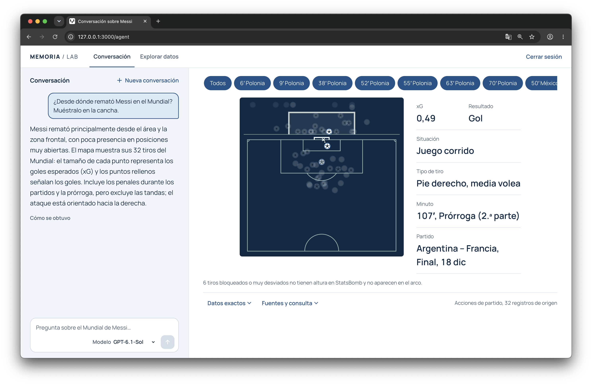
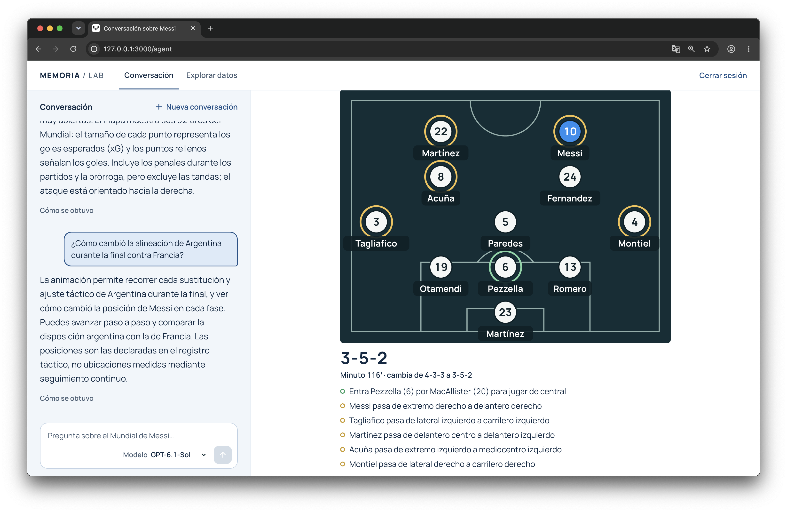
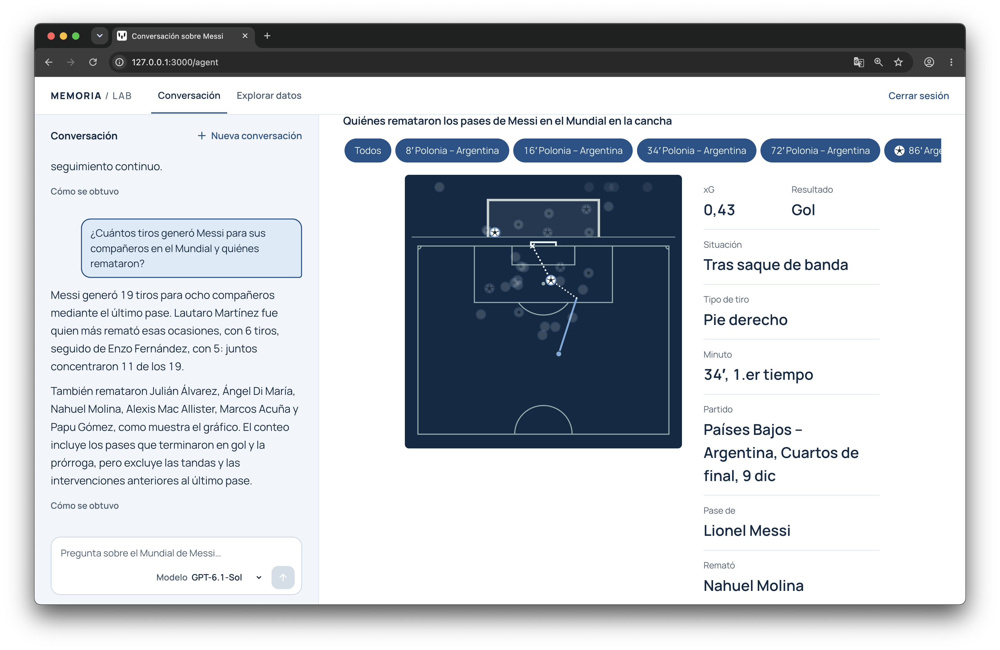

<div align="center">

# Messi · Memoria / Lab

### El Mundial de Messi, contado con imágenes y datos

Una experiencia de escritorio que une una galería narrativa con un agente conversacional para explorar los siete partidos de Argentina en Qatar 2022. Pregunta en lenguaje natural; el agente consulta datos de StatsBomb y los convierte en visualizaciones con contexto y límites claros.

[Explorar el prototipo](#el-prototipo) · [Iniciar localmente](#iniciar-localmente) · [Documentación](#documentación)

</div>

<p align="center">
  
</p>

## Una historia que también se puede explorar

La galería recorre momentos de la historia mundialista de Messi. El laboratorio conecta esa narrativa con preguntas sobre tiros, pases, alineaciones, resultados y evolución por partido.

<p align="center">
  
  
</p>
<p align="center">
  
  
</p>

## Qué puedes explorar

- **Tiros y creación:** ubicación de los remates de Messi y jugadas que terminan en tiro.
- **Partidos:** marcador y cronología de goles, tarjetas y sustituciones.
- **Alineaciones:** once inicial, cambios de formación y posiciones por etapa.
- **Compañeros y equipos:** redes de pases, comparaciones y métricas por encuentro.
- **Evolución:** tendencias partido a partido y cifras agregadas del torneo.

El alcance de datos cubre los siete partidos de Argentina en el Mundial 2022. Las visualizaciones representan eventos registrados; no estiman seguimiento continuo ni carga física.

## El prototipo

La galería completa reúne 16 pantallas narrativas y analíticas. Abre la [galería del prototipo](prototype/README.md) para verlas en detalle.

<details>
<summary>Ver las 16 pantallas</summary>

### Narrativa del Mundial

| Pantalla | Vista |
| --- | --- |
| 01 · El peso de la gloria |  |
| 02 · Una camiseta, toda una vida |  |
| 03 · Es increíble, pero no se me da |  |
| 04 · El mundo cabe en sus manos |  |
| 05 · El último baile en casa |  |

### Conversación y visualizaciones

| Pantalla | Vista |
| --- | --- |
| 06 · Explorar el Mundial de Messi |  |
| 07 · Tiros de Messi en el Mundial |  |
| 08 · Estadísticas Argentina–Francia |  |
| 09 · Argentina en 4-3-3 |  |
| 10 · Argentina en 3-5-2 |  |
| 11 · Pases que terminaron en remate |  |
| 12 · Rematadores de pases de Messi |  |
| 13 · Cronología de la final |  |
| 14 · Evolución de Messi por Mundial |  |
| 15 · Indicadores de Messi en Mundiales |  |
| 16 · Messi y Mbappé en la final |  |

</details>

## Iniciar localmente

### Requisitos

- Python 3.11 o posterior y Node.js 20.9 o posterior.
- Artefactos Gold locales de StatsBomb World Cup 2022.
- Cuenta elegible para autorizar el uso del plan ChatGPT mediante OAuth. No se necesita API key.

### Preparar

Desde la raíz del repositorio:

```sh
uv venv .venv
uv pip install --python .venv/bin/python -e 'apps/api[test]'
npm --prefix apps/web ci
.venv/bin/python scripts/discover_gold.py
.venv/bin/python scripts/generate_demo.py
```

### Ejecutar

Inicia la API en una terminal:

```sh
.venv/bin/python -m uvicorn app.main:app --host 127.0.0.1 --port 8000 --no-access-log
```

Inicia la interfaz en otra:

```sh
npm --prefix apps/web run dev -- --hostname 127.0.0.1 --port 3000
```

Abre [http://127.0.0.1:3000/agent](http://127.0.0.1:3000/agent) y selecciona **Continue with ChatGPT** para autorizar la cuenta. El agente descubre los modelos disponibles. Sin autorización puedes explorar los datos y las visualizaciones en modo determinista.

El estado OAuth local se guarda en `AGENT_AUTH_STATE_B64` dentro del `.env` de la raíz, con permisos `0600`. No copies ese valor a `.env.example` ni lo subas a Git.

## Documentación

- [Guía de demo](docs/DEMO_CHEAT_SHEET.md)
- [Catálogo de datos Gold](docs/GOLD_CATALOG.md) · [esquema JSON](docs/GOLD_CATALOG.json)
- [Jugadores, selecciones y partidos](docs/GOLD_ENTITIES.json)
- [Arquitectura, seguridad y límites](docs/ARCHITECTURE.md)
- [Verificación](docs/VERIFICATION.md)

## Datos y atribución

Los datos de fútbol provienen de [StatsBomb Open Data](https://github.com/statsbomb/open-data). La interfaz se diseñó para escritorio y laptop.
